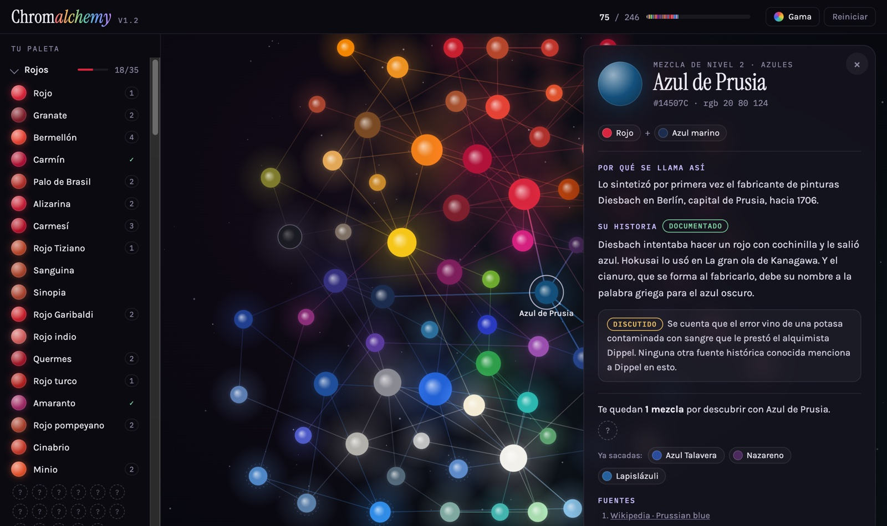
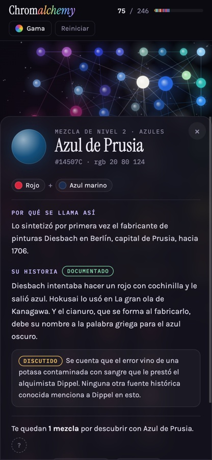

# Chromalchemy

**246 colores reales. Mézclalos y descubre su historia.**

### ▶ [Jugar](https://icaraballo.github.io/Chromalchemy/)



Un juego web de descubrir colores mezclándolos, en la línea de *Little Alchemy*, pero con
colores que existen de verdad. Empiezas con rojo, amarillo, azul, blanco y negro. Sueltas
uno sobre otro y, si la pareja tiene receta, aparece un color nuevo: el bermellón, el azul de
Prusia, el verde París… Cada uno trae su ficha: por qué se llama así, su historia y de
dónde sale cada dato.

## Cómo se juega

- **Mezcla soltando un color sobre otro.** Desde la paleta, arrástralo sin más; en la
  constelación, **mantén pulsada la bola medio segundo** para coger una muestra. Si reaccionan,
  explosión y color nuevo; si no, tiemblan.
- **Coloca las bolas a tu gusto**: en la constelación, arrastrar una bola sin esperar la mueve
  y se queda donde la dejas. «Reordenar» las devuelve a su sitio por familias.
- **Acércate** a la constelación con dos dedos (o la rueda del ratón) y muévete arrastrando el
  fondo: de cerca se leen todos los nombres. «Ver toda» vuelve a la vista entera.
- En el móvil, la paleta es una **hoja que se desliza** desde abajo: plegada, una tira con tus
  colores; abierta, la paleta por familias.
- **¿Atascado?** Las bolas con las que puedes descubrir algo laten más, y un **puntito** marca
  en la paleta los «?» que ya están a tu alcance. **Pide una pista** con el botón o tocando un
  «?»: primero un acertijo, luego un ingrediente, luego los dos. Si ese color aún no se puede
  hacer, la pista te lleva al primero que te falta.
- **Toca un color** para leer su historia y ver cuántas mezclas le quedan por descubrir.
- **«Gama»** abre una rueda de tonos con huecos donde faltan colores: te dice por dónde
  buscar, no qué buscar.
- Hay **logros** al llegar a la mitad y al total de cada familia, al 25, 50 y 75 % de la
  gama y al reunir todos los colores con leyenda, y la partida **se guarda**
  sola en el navegador.
- **«Opinar»** abre unas pocas preguntas dentro del juego; las respuestas llegan a un
  formulario de Google sin salir de la partida.

Funciona en el ordenador y en el móvil.



## Lo que hay detrás

- **Historias con rigor.** Cada ficha dice cuánto se sabe de lo que cuenta: *documentado*,
  *discutido* o *leyenda*. Lo dudoso va aparte y marcado; nunca se presenta una leyenda como
  hecho. 347 fuentes enlazadas (RAE, Wikipedia, el CAMEO del Museum of Fine Arts de Boston…).
- **Mezcla de pintura, no de luz.** Las recetas se calcularon con
  [Mixbox](https://github.com/scrtwpns/mixbox), que imita pigmentos reales (azul y amarillo
  dan verde de verdad). 26 se eligieron a mano por su historia —el azul de Prusia sale de rojo
  y azul marino porque Diesbach buscaba un rojo—; el resto, con un algoritmo que busca la
  mezcla más parecida y además creíble. Desde los 5 básicos se llega a los 246, y hay un test
  que lo comprueba.
- **Sin frameworks ni servidor.** HTML, CSS y JavaScript con módulos ES; la constelación es un
  canvas con una pequeña simulación de fuerzas. Los datos van aparte, en
  `data/colores.json`.

## Estructura

| Ruta | Qué es |
|---|---|
| `index.html`, `css/`, `js/` | El juego. `js/main.js` arranca; cada módulo lleva su cabecera |
| `fonts/` | Las tipografías, con su licencia |
| `data/colores.json` | Los 246 colores: familia, color, receta, historia, certeza y fuentes |
| `tests/recetas.test.mjs` | Comprueba que desde los 5 básicos se llega a los 246 |
| `tools/calcular-recetas.js` | El script que generó las recetas (Node + Mixbox) |
| `tools/version.sh` | Cambia la versión antes de publicar |
| `reference/` | El prototipo de un solo archivo del que salió el juego |

## Probar en local

Los módulos no cargan abriendo el archivo con doble clic (`file://`): hay que servir la
carpeta.

```bash
npm run serve        # python3 -m http.server 8765 → http://127.0.0.1:8765
npm test             # las recetas
```

No hace falta `npm install`: el juego no tiene dependencias.

Al publicar una versión nueva: `tools/version.sh 1.3` (cambia la etiqueta y el `?v=` de cada
archivo en `index.html`, para que el navegador no mezcle versiones). Un módulo nuevo hay que
añadirlo a mano al `importmap` de `index.html`.

### Recalcular las recetas

Sólo si cambia el catálogo; el juego no usa Mixbox al jugar.

```bash
npm install mixbox@2.0.0
node tools/calcular-recetas.js entrada.json salida.json
```

## Licencia

- **Código**: MIT ([`LICENSE`](LICENSE)).
- **Textos de las fichas** (`nombre`, `historia`, `nota` y `acertijo` en `data/colores.json`):
  CC BY 4.0 ([`LICENSE-TEXTOS.md`](LICENSE-TEXTOS.md)).
- **Mixbox**, que sólo usa `tools/calcular-recetas.js` y no va incluido, es de Secret Weapons
  con licencia CC BY-NC 4.0 (uso no comercial).
- **Tipografías** (Instrument Serif, Karla e IBM Plex Mono), en `fonts/` con su licencia: SIL
  Open Font License 1.1.

## Privacidad

Sin cookies ni analítica. La partida se guarda solo en tu navegador. Las letras se sirven desde
el propio juego. Si pulsas «Enviar» en «Opinar», tus respuestas, la versión y cuántos colores
llevas van a un formulario de Google; nombre y contacto, solo si los pones. En Safari, si pasas
más de 7 días sin abrirlo, el navegador puede borrar la partida.

Hecho por Iñigo Caraballo con Claude (Anthropic).
